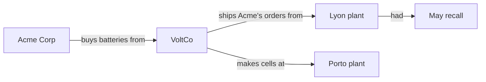

# Common Ground

**A knowledge graph as a shared medium for communication between humans and language models.**

Most systems that combine LLMs (large language models) with knowledge graphs treat the graph as a tool: either a retrieval index the model reads (GraphRAG, HippoRAG), a memory store the model writes (Graphiti/Zep), or a dataset humans clean up (human-in-the-loop verification tools).

Common Ground treats the graph as **the conversation itself**. Humans and models both propose links, and both must say *why*. Either side can agree, disagree or say it is unsure, and objections must give a reason. Nothing is overwritten: a revision supersedes the old claim and keeps it on record. The result is a knowledge base *and* a readable record of how human and model understanding converged, or where it still doesn't.

> Status: early prototype (v0.1). The model's turns in the example are scripted; connecting a live LLM is the next step.

## The idea in one example

A model reads three documents and proposes a chain: Acme buys from VoltCo, VoltCo makes cells in Lyon, Lyon had a recall. Plain retrieval would stop there.

Here, the human reviewing it knows something the documents don't say: VoltCo has a second plant in Porto. She marks the middle link *unsure* and says why. When the question "is Acme affected by the recall?" is asked, the system reports that the answer rests on that weak link. She adds the Porto plant; the model finds a purchase order proving Acme's orders ship from Lyon and revises its claim. Asked again, the conclusion now rests only on links both sides accept, and the full history of how they got there is kept.



Run it yourself:

```bash
python examples/acme_recall.py
```

## Design principles

1. **Every link needs a reason.** A claim without a rationale is rejected. So is disagreeing or being unsure without saying why, because the other side needs something to respond to.
2. **Agreement is explicit.** A claim is only *accepted* once someone other than its proposer agrees and nobody objects. Statuses: `proposed`, `accepted`, `uncertain`, `disputed`, `superseded`.
3. **Nothing is erased.** Revisions create a new claim linked to the old one. Every action goes into an append-only log.
4. **Answers show their weakest link.** Multi-hop answers report which claim in the chain is least settled, so a confident-looking conclusion can't hide a contested step.
5. **Humans and models are equal participants.** The same actions are available to both; the log records who did what.

## Usage

```python
from commonground import CommonGround

g = CommonGround()
g.add_participant("model", "model")
g.add_participant("nina", "human")

c = g.propose("model", "VoltCo", "makes cells at", "Lyon plant",
              "Doc 2 describes production in Lyon.", sources=["doc2"])
g.respond(c.id, "nina", "unsure", "VoltCo also has a Porto plant.")

paths = g.find_paths("Acme Corp", "May recall")  # chains of claims, shortest first
g.explain_path(paths[0])                   # readable, with objections and weakest link
g.why(c.id)                                # full history of one claim
g.open_questions()                         # what still needs discussion
g.to_context()                             # text to give any LLM as context
g.to_mermaid()                             # diagram
g.save("graph.json")                       # everything, including the log
```

No dependencies beyond the Python standard library (3.10+). Tests use pytest:

```bash
pip install -e ".[test]"
pytest
```

## Roadmap

- [ ] LLM adapter: the model reads `to_context()` and returns propose / respond / revise actions as JSON
- [ ] Interactive web view where people click a link to challenge it
- [ ] Entity resolution (merging "VoltCo" and "VoltCo SA")
- [ ] Time-bounded claims ("true from 2019 to 2023")
- [ ] Multiple humans and models, with per-participant views of agreement

## Related work

- Edge et al. (2024), *From Local to Global: A Graph RAG Approach to Query-Focused Summarization* ([arXiv:2404.16130](https://arxiv.org/abs/2404.16130))
- Gutiérrez et al. (2024), *HippoRAG: Neurobiologically Inspired Long-Term Memory for LLMs* ([arXiv:2405.14831](https://arxiv.org/abs/2405.14831))
- Rasmussen et al. (2025), *Zep: A Temporal Knowledge Graph Architecture for Agent Memory* ([arXiv:2501.13956](https://arxiv.org/abs/2501.13956))
- Wikidata and the [Wikidata Embedding Project](https://www.wikidata.org/wiki/Wikidata:Embedding_Project)
- Clark & Brennan (1991), *Grounding in Communication*, the psychology of building common ground

## Citing this work

If this idea or code is useful to you, please cite it. GitHub's **Cite this repository** button uses [`CITATION.cff`](CITATION.cff).

## Licence

Code: [MIT](LICENSE). Written material (this README and anything in `docs/`): [CC BY 4.0](https://creativecommons.org/licenses/by/4.0/). Both allow reuse with attribution.
