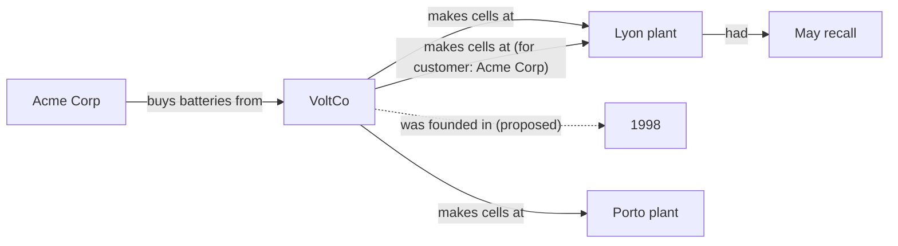

# Common Ground

**A knowledge graph as a shared medium for communication between humans and language models.**

Most systems that combine LLMs (large language models) with knowledge graphs treat the graph as a tool: either a retrieval index the model reads (GraphRAG, HippoRAG), a memory store the model writes (Graphiti/Zep), or a dataset humans clean up (human-in-the-loop verification tools).

Common Ground treats the graph as **the common ground** between people and models: the shared record of what each side has claimed, why, and how far they agree. The conversation can stay in plain language; what changes is that each turn leaves behind something both sides can point at, such as a claim to agree with, challenge or narrow, or a question to answer. Humans and models both propose links, and both must say *why*. Either side can agree, disagree, doubt a claim or ask a question about it, and objections must give a reason. Nothing is overwritten. The result is a knowledge base *and* a readable record of how human and model understanding converged, or where it still doesn't.

The name comes from Clark & Brennan's account of *grounding*: people communicate by building up mutual knowledge step by step, and checking it as they go. A chat transcript buries that knowledge in a long scroll. Here it is explicit, and every piece of it can be referred to by id.

> Status: early prototype (v0.2). The model's turns in the example are scripted; connecting a live LLM is the next step. [docs/design.md](docs/design.md) explains the design choices and what changed from v0.1.

## The idea in one example

A model reads three documents and proposes a chain: Acme buys from VoltCo, VoltCo makes cells in Lyon, Lyon had a recall. Plain retrieval would stop there and answer "yes, Acme is affected".

The human reviewing it has no reason to doubt any of those claims, so she agrees with all three. But she knows something the documents don't say: VoltCo has a second plant, in Porto. So she *asks a question* about the middle link: which plant makes Acme's cells? That is different from doubting it. VoltCo really does make cells in Lyon; the claim just doesn't say whose. Asked "is Acme affected by the recall?", the system reports that every link is accepted but the chain still has an open question.

She adds the Porto plant. The model retrieves Acme's purchase order, which ships from Lyon, and *refines* its claim to "VoltCo makes cells at Lyon, for customer Acme Corp", offering it as the answer. The original claim stays, because it is still true. Asked again, the system leads with the chain through the refined claim, where every link is accepted and no question is open, and says the chain through the original claim doesn't settle the question by itself. The full history of how they got there is kept.

Solid arrows are accepted; the dotted one is a claim nobody has reviewed yet, because the question didn't depend on it.



Run it yourself:

```bash
python examples/acme_recall.py
```

## Design principles

1. **Every link needs a reason.** A claim without a rationale is rejected. So is disagreeing or doubting without saying why, because the other side needs something to respond to.
2. **Doubts and questions are different.** `unsure` means "this may be false". To ask about a claim without doubting it, raise a question. It is answered once someone offers a claim as the answer and that claim is accepted.
3. **Agreement has to mean something.** A claim is only *accepted* once an independent participant agrees and nobody objects. Independent means not the proposer, and not anyone sharing the proposer's identity, such as a second instance of the same model. Models must say why they agree, because language models tend to agree too readily. Claims can only cite registered sources, and the log records who supplied each one. Statuses: `proposed`, `accepted`, `uncertain`, `disputed`, `superseded`.
4. **Nothing is erased.** A claim that was wrong is *revised*: the new claim supersedes it and the old one stays on record. A claim that was true but too broad is *refined*: both stay. Every action goes into an append-only log.
5. **Claims carry their conditions.** Qualifiers such as `{"for customer": "Acme Corp"}` or `{"from": "2019", "until": "2023"}` keep scope and time out of the relation name. An optional vocabulary stops synonyms from splitting the graph.
6. **Answers show their weakest link.** Multi-hop answers report which claim in the chain is least settled and any question on it that is still open, so a confident-looking conclusion can't hide a contested step.
7. **Human attention goes where it matters.** The review queue puts first the unsettled claims that the questions being asked depend on.
8. **Humans and models are equal participants.** The same actions are available to both, and the log records who did what. The one difference is that models must explain their agreement (configurable).

## Usage

```python
from commonground import CommonGround

g = CommonGround()                        # vocabulary=[...] fixes the allowed relations
g.add_participant("model", "model")       # identity="..." groups instances of one model
g.add_participant("nina", "human")
g.add_source("doc2", "VoltCo company profile")  # claims can only cite registered sources

c = g.propose("model", "VoltCo", "makes cells at", "Lyon plant",
              "Doc 2 describes production in Lyon.", sources=["doc2"])
g.respond(c.id, "nina", "agree")          # or "disagree" / "unsure", with a reason
q = g.ask("nina", "Which plant makes Acme's cells?", about=[c.id])
r = g.refine(c.id, "model", "Narrowing to Acme's orders.",
             qualifiers={"for customer": "Acme Corp"},
             rationale="Acme's purchase order ships from Lyon.")  # revise() if c was wrong
g.answer(q.id, "model", r.id)             # answered once r is accepted

paths = g.find_paths("VoltCo", "Lyon plant")  # chains of claims, shortest and best supported first
g.explain_path(paths[0])                  # readable, with objections, questions and weakest link
g.why(c.id)                               # full history of one claim
g.review_queue(focus=[("VoltCo", "Lyon plant")])  # unsettled claims, most depended on first
g.open_questions()                        # questions with no accepted answer
g.to_context()                            # text to give any LLM as context
g.to_mermaid()                            # diagram
g.save("graph.json")                      # everything, including the log
```

No dependencies beyond the Python standard library (3.10+). Tests use pytest:

```bash
pip install -e ".[test]"
pytest
```

## Roadmap

- [ ] LLM adapter: the model reads `to_context()` and returns propose / respond / ask / answer / refine / revise actions as JSON
- [ ] A small study comparing chat alone with chat plus the graph ([plan](docs/design.md#how-to-test-the-idea))
- [ ] Interactive web view where people click a link to challenge it
- [ ] Entity resolution (merging "VoltCo" and "VoltCo SA")
- [ ] Queries that understand time qualifiers ("true from 2019 to 2023")
- [ ] Multiple humans and models, with per-participant views of agreement
- [x] Questions, refinements, qualifiers, registered sources, independent agreement and a review queue (v0.2)

## Related work

- Edge et al. (2024), *From Local to Global: A Graph RAG Approach to Query-Focused Summarization* ([arXiv:2404.16130](https://arxiv.org/abs/2404.16130))
- Gutiérrez et al. (2024), *HippoRAG: Neurobiologically Inspired Long-Term Memory for LLMs* ([arXiv:2405.14831](https://arxiv.org/abs/2405.14831))
- Rasmussen et al. (2025), *Zep: A Temporal Knowledge Graph Architecture for Agent Memory* ([arXiv:2501.13956](https://arxiv.org/abs/2501.13956))
- Wikidata and the [Wikidata Embedding Project](https://www.wikidata.org/wiki/Wikidata:Embedding_Project); Vrandečić & Krötzsch (2014), *Wikidata: A Free Collaborative Knowledgebase*, Communications of the ACM 57(10): references, qualifiers and ranks on every statement
- Clark & Brennan (1991), *Grounding in Communication*, the psychology of building common ground
- Doyle (1979), *A Truth Maintenance System*, Artificial Intelligence 12(3): justifications for every belief, withdrawn when what they rest on is withdrawn
- Kunz & Rittel (1970), *Issues as Elements of Information Systems*: IBIS, which separates questions from the positions and arguments about them
- Dung (1995), *On the Acceptability of Arguments and its Fundamental Role in Nonmonotonic Reasoning, Logic Programming and n-Person Games*, Artificial Intelligence 77(2)
- Sharma et al. (2023), *Towards Understanding Sycophancy in Language Models* ([arXiv:2310.13548](https://arxiv.org/abs/2310.13548)): why a model's agreement needs a reason

Most of this machinery predates language models. What Common Ground adds is using it as a two-way channel between people and models. [docs/design.md](docs/design.md#where-this-sits) compares it with each.

## Citing this work

If this idea or code is useful to you, please cite it. GitHub's **Cite this repository** button uses [`CITATION.cff`](CITATION.cff).

## Licence

Code: [MIT](LICENSE). Written material (this README and anything in `docs/`): [CC BY 4.0](https://creativecommons.org/licenses/by/4.0/). Both allow reuse with attribution.
